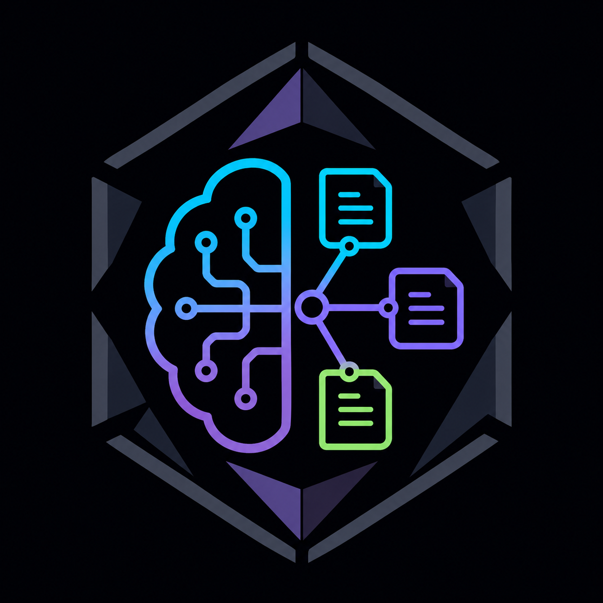
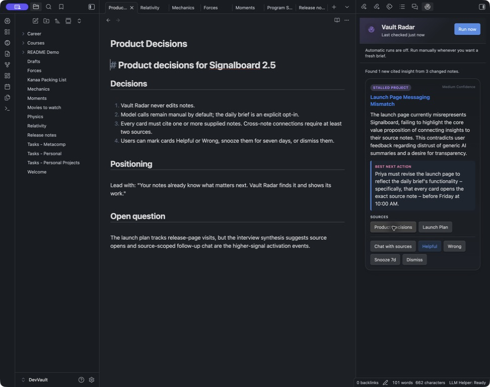
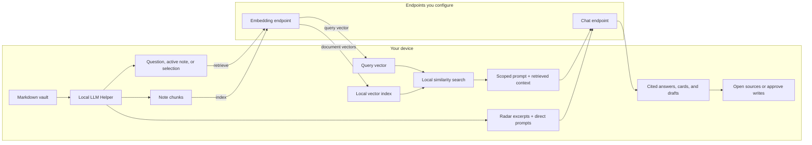
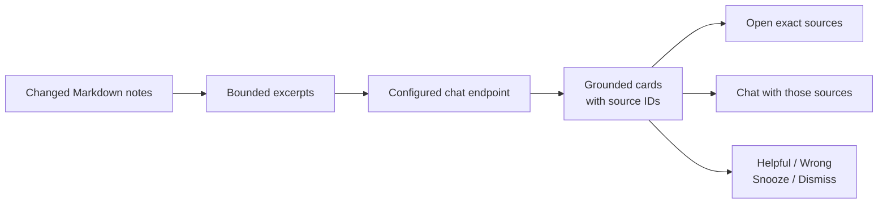
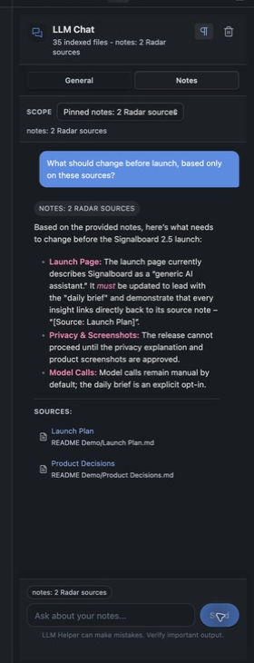

<p align="center">
  
</p>

<h1 align="center">Local LLM Helper</h1>

<p align="center">
  <strong>Your notes already know what matters next. Find it—and see the evidence.</strong>
</p>

<p align="center">
  Cited Vault Radar briefs, note-grounded chat, semantic discovery, and approval-gated workflows<br>
  inside Obsidian, powered by Ollama or any OpenAI-compatible endpoint.
</p>

<p align="center">
  <a href="https://github.com/manimohans/obsidian-local-llm-helper/releases/latest"></a>
  <a href="https://github.com/manimohans/obsidian-local-llm-helper/actions/workflows/ci.yml"></a>
  <a href="https://obsidian.md/plugins?id=local-llm-helper"></a>
  <a href="LICENSE"></a>
</p>

<p align="center">
  <a href="#install">Install</a> ·
  <a href="#quick-start-with-ollama">Quick start</a> ·
  <a href="#what-leaves-your-vault">Privacy</a> ·
  <a href="https://github.com/manimohans/obsidian-local-llm-helper/releases">Releases</a>
</p>

<p align="center">
  
  <br>
  <sub>Vault Radar turns changed notes into a small, cited brief. Captured in a synthetic demo vault with file navigation hidden.</sub>
</p>

## From questions to signals

Chat is useful when you know what to ask. Vault Radar adds another loop: it turns recently changed notes into a small, cited brief you can inspect without composing a prompt. It can surface:

- a commitment that is about to slip;
- a project blocked by an unresolved decision;
- a connection that only appears across two notes;
- the next action supported by the source material.

That is **Vault Radar**. Every card cites the exact Markdown notes behind it. Open the evidence, continue with those sources in chat, mark the insight Helpful or Wrong, snooze it, or dismiss it. Radar never edits notes, and automatic runs are off until you explicitly enable them.

## What you can do

| Capability | Built for |
| --- | --- |
| **Vault Radar** | Turn changed notes into a small, cited brief of commitments, stalled work, connections, and next actions. |
| **Chat with notes** | Ask grounded questions across the vault or pin the current note, a folder, tags, or selected notes. |
| **Related Notes** | Keep semantically relevant notes visible while you write, with direct source opening and scoped chat. |
| **Text actions** | Summarize, rewrite, extract tasks, apply a custom instruction, or run saved prompts from the command palette. |
| **Review workflows** | Draft weekly reviews, meeting tasks, and project updates from indexed context. Every write still requires approval. |
| **Bring your own model** | Use Ollama, LM Studio, vLLM, LocalAI, OpenAI, or another server with OpenAI-compatible endpoints. |

## How it works

Local LLM Helper runs inside Obsidian. It sends only the context needed for the feature you invoke, then keeps its semantic index and plugin state locally in your vault.



There is no Local LLM Helper cloud service: requests go only to chat and embedding endpoints you configure, plus a search provider you explicitly select when you run web search.

## Vault Radar: from signal to evidence

Radar reads a bounded set of recently changed Markdown notes and asks your configured chat model for high-signal, source-grounded cards.



After the first successful scan, Radar is incremental: unchanged notes are not repeatedly sent. A resilient local state file remembers scan versions, citations, feedback, snoozes, and dismissals. Large-vault state and prompt size are both bounded.

<p align="center">
  
  <br>
  <sub>Source-scoped chat stays pinned to the two Radar sources and returns clickable citations. Captured in a synthetic demo vault.</sub>
</p>

## Quick start with Ollama

### 1. Install and run models

```bash
ollama pull gemma3
ollama serve
```

For semantic search, Related Notes, and RAG chat, also install an embedding model:

```bash
ollama pull nomic-embed-text
```

### 2. Connect the plugin

Open **Settings → Local LLM Helper** and set:

| Setting | Value |
| --- | --- |
| Provider | `Ollama` |
| Chat/default server URL | `http://localhost:11434` |
| Chat model | `gemma3` |
| Embedding model | `nomic-embed-text` |

### 3. Try the core loop

1. Open the command palette with `Cmd/Ctrl + P`.
2. Run **Vault Radar: Open**.
3. Click **Run now**.
4. Open a cited note or choose **Chat with sources**.

Radar does not require an embedding index. To use RAG chat and Related Notes, run **Notes: Index notes for RAG** once after configuring the embedding model.

## Model and endpoint compatibility

The plugin uses the OpenAI-compatible API format rather than a provider-specific SDK.

| Operation | Endpoint | Used by |
| --- | --- | --- |
| Chat completion | `/v1/chat/completions` | Vault Radar, chat, text actions, tagging, RAG answers, workflows |
| Embeddings | `/v1/embeddings` | Notes index, semantic retrieval, Related Notes |
| Model discovery | `/v1/models` | Chat and embedding model pickers |

Chat and embeddings may use different server URLs and API keys. This is useful when, for example, a local Ollama instance handles chat while a separate OpenAI-compatible service handles embeddings.

Ollama has been smoke-tested end to end. The shared OpenAI-compatible request contract, JSON-mode fallback, timeouts, retries, response validation, and user-facing errors are unit-tested through injected transports and centralized in one client.

## What leaves your vault

Local LLM Helper has no telemetry and no hosted backend of its own. Data goes only to endpoints you configure or features you invoke.

| Feature | Data sent | When |
| --- | --- | --- |
| Vault Radar | Bounded excerpts from changed Markdown notes; when feedback exists, kind/title metadata for up to six Helpful and six Wrong cards | Manual run, or daily after explicit opt-in |
| Chat and text actions | Your prompt, selection, active-note context, or chosen note scope | When you submit a request |
| RAG indexing | Note chunks and supported attachment text | When indexing runs |
| RAG and Related Notes retrieval | Your question, active-note text, or selected text | When semantic retrieval queries the embedding endpoint |
| Web search | Your query goes to the selected search provider; the query and returned titles/snippets then go to your configured chat endpoint for synthesis | Only when you run web search |

Endpoints can be local or remote. A local URL does not automatically make a remote model private, and a remote URL can send note content off-device. Review [Privacy and Capabilities](PRIVACY.md) before enabling background features.

Safety defaults:

- automatic Vault Radar runs are off;
- automatic indexing is off;
- Vault Radar never writes to notes;
- workflow and Vault Action writes require explicit approval;
- API keys, settings, indexes, and Radar state are stored locally in the vault's plugin data.

## More workflows

### Scoped notes chat

Choose the context before asking:

- entire vault;
- current note or folder;
- one or more tags;
- selected Related Notes;
- the exact sources from a Vault Radar card.

Answers include clickable source references. Markdown rendering is optional and can be toggled in the sidebar.

### Review workflows

Built-in recipes cover:

- **Weekly review** — wins, open loops, and next actions;
- **Meeting notes to tasks** — owners, commitments, and follow-ups;
- **Project status summary** — progress, risks, blockers, and next steps.

Generated note changes appear as approval cards. Nothing is written until you approve it.

### Commands and saved prompts

Use the command palette or ribbon menu for fast transformations:

- **Text:** Summarize, Make professional, Generate action items, Use as prompt;
- **Prompt:** run any saved prompt and assign it a hotkey;
- **Chat:** general chat, notes chat, current note, current folder;
- **Notes:** index, diagnostics, Related Notes;
- **Workflow:** run an approval-gated recipe;
- **Web:** search using Tavily, Brave, or self-hosted SearXNG.

## Install

### Obsidian Community Plugins

1. Open **Settings → Community plugins → Browse**.
2. Search for **Local LLM Helper**.
3. Select **Install**, then **Enable**.

You can also open the [plugin listing](https://obsidian.md/plugins?id=local-llm-helper).

### Manual installation

1. Download `main.js`, `manifest.json`, and `styles.css` from the [latest release](https://github.com/manimohans/obsidian-local-llm-helper/releases/latest).
2. Place them in `<vault>/.obsidian/plugins/local-llm-helper/`.
3. Reload Obsidian and enable **Local LLM Helper** under Community plugins.

## Development

Requirements: Node.js 20 or later.

```bash
git clone https://github.com/manimohans/obsidian-local-llm-helper.git
cd obsidian-local-llm-helper
npm ci
npm run check
```

`npm run check` runs the Vitest suite, TypeScript validation, and the production bundle. See [CONTRIBUTING.md](CONTRIBUTING.md) for local-vault setup and contribution guidelines.

## Project links

- [Releases](https://github.com/manimohans/obsidian-local-llm-helper/releases) — version history and downloadable assets
- [Privacy and Capabilities](PRIVACY.md) — network, vault, clipboard, background, and storage behavior
- [Issues](https://github.com/manimohans/obsidian-local-llm-helper/issues) — bug reports and feature requests
- [Contributing](CONTRIBUTING.md) — development workflow and release checks

## License

[MIT](LICENSE) — use it, modify it, and build on it.
